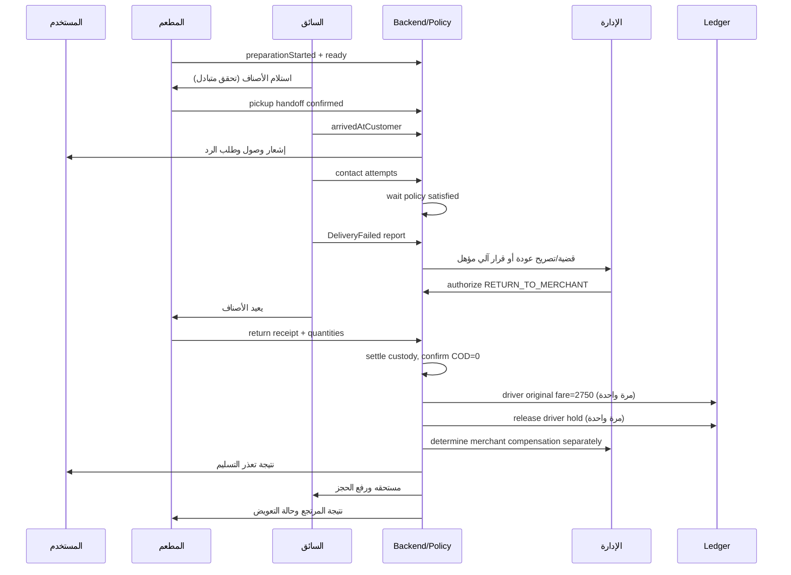

# مواصفة نظام إدارة الإلغاء، تعذر التوصيل، المرتجعات، الشكاوى والتسويات

**الاسم التقني:** Order Exceptions, Custody & Settlement Resolution (OECSR)  
**الإصدار:** Draft v1.0 — قابل للمراجعة قبل التفعيل الإنتاجي  
**القنوات:** تطبيق المستخدم، تطبيق السائق، تطبيق المطعم، لوحة إدارة المنصة  
**نطاق المدفوعات الحالي:** نقد عند التسليم (COD) فقط  
**العملة الأساسية:** الدينار العراقي (IQD)  
**الغاية:** مرجع تنفيذي واضح لـ Codex، وليس وصفاً لما نُفذ بالفعل.

> **تنبيه تنفيذ مهم:** لا تفترض أن أسماء الكيانات والجداول والـ APIs المذكورة موجودة في المستودع. افحص الشيفرة والاختبارات وسجلات الترحيل ومخطط البيانات أولاً، وأنشئ جدول توافق بين الموجود والمقترح. حافظ على محرك موجات إسناد السائقين، وحجز الضمان، ودفتر الحسابات الحالي، وواجهات التطبيقات الموجودة، ما لم يثبت احتياج تعديل موثق. لا تشغّل سياسة مالية جديدة على طلبات سابقة، ولا تعيد كتابة سجلات مالية تاريخية. هذه مسودة تصميم كاملة قابلة للتنفيذ على مراحل، وليست موافقة ضمنية على النشر الإنتاجي أو الرسوم الجديدة.

---

## 1) الهدف والنطاق والقرارات الثابتة

### 1.1 النطاق

توحيد معالجة الاستثناءات منذ إنشاء الطلب وحتى الشكاوى بعد التسليم، بما في ذلك الإلغاء، انسحاب السائق، عدم العثور على سائق، تعذر الوصول، تغيير العنوان، الرفض، العطل، الحوادث، الأصناف الناقصة/الخاطئة/التالفة، المرتجعات، التصرف المصرح به، نقل العهدة، التسليم الجزئي، النقد المحصل كلياً/جزئياً/بالزيادة، الاسترجاع النقدي، التعويضات، المسؤولية المشتركة، النزاعات والاعتراضات، والأخطاء التقنية والتكرار والتزامن.

### 1.2 قرارات معتمدة لهذه المسودة

- **COD فقط:** لا تنشئ مسارات بطاقات، Stripe، محافظ دفع إلكترونية أو عمليات رد إلى بطاقة.
- **أجرة العودة الإضافية = صفر** في الإصدار الحالي؛ افصلها في إعداد سياسة `returnExtraFeeEnabled=false` ومقدار `returnExtraFee=0` لدعم تفعيل لاحق *دون تطبيق بأثر رجعي*. لا تعني صفراً لأجرة الرحلة الأصلية.
- **بعد استلام السائق الطعام ومحاولة تسليم صحيحة ومثبتة دون خطأ عليه:** استحقاقه المقترح 100% من أجرة العرض الأصلية المؤهلة، **دون إكرامية غير محصلة ودون أجرة عودة إضافية**.
- **رفض العرض أو انقضاء مهلة العرض قبل قبوله:** لا أجرة. **الانسحاب بعد القبول وقبل استلام الأصناف:** لا أجرة تلقائية في v1، ويمكن تعويض إداري استثنائي مسبب.
- **عطل أو طارئ بعد الاستلام وقبل محاولة توصيل مستوفية:** لا إلغاء تلقائي ولا إسقاط تلقائي للأجرة؛ قرار حالة وفق العمل المنجز والأدلة والمسؤولية.
- **حق المطعم مستقل عن إعادة الأصناف وأجرة السائق.** الطعام المُحضّر قد يستحق تعويضاً وإن عاد كاملاً إذا لم يعد قابلاً للبيع، بشرط الاتفاقية والأدلة والمسؤولية. لا يُستنتج تعويض مطعم تلقائياً من مجرد «تم التحضير» غير موثق.
- **لا تحمل المستخدم أو المطعم أو السائق تكلفة اعتماداً على سبب اختاره طرف واحد.** يُفصل البلاغ (`allegedReason`) عن النتيجة المثبتة (`confirmedResponsibility`).
- **المنصة تمول المدفوعات المستحقة التي لا يقابلها نقد محصل في الوقت الراهن**، ويمكن تسجيل مطالبة استرداد من الطرف المسؤول *فقط إذا أجازت الاتفاقية والسياسة ذلك* وبقرار موثق. لا تساوي المطالبة النقد المحصل.
- **لا حذف أو إعادة كتابة قيد مالي تاريخي.** التصحيح قيود عكسية/تعديلية Append-only مربوطة بالأصل، مع مانع تكرار.
- **الإلغاء قبل استلام السائق** مختلف عن **فشل تسليم بعد الاستلام**، ومختلف عن **مرتجع فعلي**، ومختلف عن **شكوى بعد اكتمال التسليم**.
- **العهدة لا تعني التعويض:** اكتمال رد العهدة قد يحرر ضمان السائق، فيما يستمر نزاع مستحق المطعم/المستخدم بصورة مستقلة إذا لم تكن هناك مساءلة للسائق.
- **لا تسليم دون نقد افتراضياً:** لا تفعيل افتراضي لترك الطلب عند الباب عند عدم الرد في طلب COD.
- **العودة الفيزيائية ليست إلزامية لكل طعام.** خيار disposition يحدد: عودة للمطعم، نقل عهدة لسائق بديل، أو تصرف آمن مرخص/موثق. لا يُسمح للسائق بتحديد إتلاف/احتفاظ من تلقاء نفسه.

### 1.3 خارج النطاق الحالي، لكن يستوعبه التصميم

الدفع بالبطاقات، تعدد عملات الطلب الواحد، فرض غرامة تلقائية على المستخدم دون آلية دفع، أجرة عودة إضافية، فوترة اشتراكات، طلبات من عدة مطاعم في سلة واحدة، تنظيم معالجة منتجات خاضعة لقيود خاصة، بيع الطعام المرتجع مجدداً خارج سياسة سلامة موثقة، أو إتاحة التصرف بالحيازة دون موافقة.

---

## 2) المصطلحات والحقائق المستقلة (Bounded Contexts)

لا تجعل `order.status` مصدراً وحيداً لكل شيء. يجب تمثيل الآتي استقلالياً:

| السياق | مسؤولياته | مثال |
|---|---|---|
| `Order` | الحالة التجارية للطلب، الأصناف الأصلية والأسعار والنسخة المرجعية | Delivered, Cancelled, DeliveryFailed |
| `OrderItems` | الكميات المطلوبة، المحضرة، المستلمة، المسلّمة، المعادة، التالفة/المفقودة | صنف 2 وحدات، سُلّمت وحدة |
| `DeliveryAssignment` | عروض الإسناد، السائق النشط، القبول، الانسحاب، الاستلام، الوصول والمحاولات | إعادة إسناد للثاني |
| `Custody` | مسؤولية الحيازة الفعلية لكل مجموعة أصناف/كمية وعمليات التسليم المتبادل | مطعم → سائق → مطعم |
| `CashCollection` | مبلغ COD النهائي المطلوب؛ النقد الذي انتقل فعلياً بين الأشخاص، وأدلة الاستلام | CashReceived 18,000 |
| `ResolutionCase` | الشكوى/الاستثناء وأدلته والأطراف ومسؤولية كل طرف والقرار | عدم رد المستخدم |
| `ReturnOrDisposition` | أمر إعادة/نقل عهدة/تصرف ومراحل التنفيذ وإثباتها | ReturnVerified |
| `Settlement` | أجرة السائق، مستحق المطعم، التعويض، رد النقد، الرسوم، مصدر التمويل | DriverPayable 2,750 |
| `Ledger` | قيود مالية غير قابلة للاستبدال مع روابط التصحيح/العكس | SettlementAdjustment |
| `PolicySnapshot` | السياسة النافذة وقت الواقعة/قبول العرض والاتفاقيات ذات الصلة | Version, effectiveAt |
| `AuditTrail` | سجل الأحداث والقرارات ومن فعلها ومتى والأدلة | AdminDecision |

**تحديد المسؤولية منفصل عن الحالة التشغيلية.** وقد تحتوي القضية على أكثر من مسبب، ولكل منهم نسبة أو مقدار مسؤولية، وقد تنتهي `UNDETERMINED` وتمولها المنصة دون اتهام تلقائي.

---

## 3) حالات الكيانات وقواعد الانتقال

### 3.1 حالة الطلب التجارية `OrderStatus`

- `CREATED` → `MERCHANT_PENDING` → `MERCHANT_ACCEPTED` → `PREPARING` → `READY_FOR_PICKUP` → `OUT_FOR_DELIVERY`.
- النتائج النهائية أو شبه النهائية: `DELIVERED`, `PARTIALLY_DELIVERED`, `CANCELLED_PRE_PICKUP`, `DELIVERY_FAILED`.
- `PARTIALLY_DELIVERED` محطة تجارية نهائية لما سُلّم، لكنها تحتاج تسوية أصناف غير مسلمة. `DELIVERED` لا يعني إغلاق كل مطالبات ما بعد التسليم.
- `CANCELLED_PRE_PICKUP` **فقط** إذا لم تنتقل عهدة الأصناف إلى سائق؛ بعد pickup يكون `DELIVERY_FAILED` أو `PARTIALLY_DELIVERED` مع حالة disposition.
- لا تعتمد حالة `RETURNED` كحالة طلب نهائية بديلة؛ العودة كيان مستقل.
- لا يمكن الرجوع من terminal إلى `OUT_FOR_DELIVERY` عند شكوى لاحقة؛ افتح قضية `POST_DELIVERY_CLAIM`.
- إن كان بالمنظومة حالات قائمة مختلفة، قدم mapping وطبقة توافق، ولا تكسر المستخدمين القدامى.

### 3.2 إسناد السائق `AssignmentStatus`

`OFFERED`, `EXPIRED`, `DECLINED`, `ACCEPTED`, `ARRIVED_AT_MERCHANT`, `PICKED_UP`, `ARRIVED_AT_CUSTOMER`, `DELIVERY_ATTEMPTING`, `DELIVERED`, `UNASSIGNED_PRE_PICKUP`, `TRANSFERRED_CUSTODY`, `DELIVERY_FAILED`, `CLOSED`.

- يحتفظ النظام بسجل كل الإسنادات؛ **إسناد نشط واحد كحد أقصى** لنفس الطلب في نقطة زمنية، باستثناء عملية نقل عهدة ذرّية ومصرح بها تقنياً.
- تحرير الضمان من إسناد سابق فقط عند عدم وجود عهدة/نقد/حجز آخر متعلق به.
- رفض/انتهاء العرض لا ينشئ مستحقاً.
- بعد `PICKED_UP` لا يُقبل `unassign` المعتاد؛ المسار الوحيد incident/transfer/return/disposition.

### 3.3 العهدة `CustodyStatus`

`WITH_MERCHANT`, `TRANSFER_PENDING`, `WITH_DRIVER`, `WITH_CUSTOMER`, `RETURN_PENDING`, `RETURN_IN_TRANSIT`, `RETURNED_TO_MERCHANT`, `TRANSFERRED_TO_OTHER_DRIVER`, `AUTHORIZED_DISPOSITION`, `LOST_OR_DISPUTED`.

كل حركة تُسجل من مالك سابق إلى مالك جديد، مع مرجع `assignmentId` و`itemQuantities` والوقت والأدلة. لا تفترض انتهاء عهدة السائق عند مجرد ضغط «أنهيت العودة» أو عند إغلاق القضية دون إثبات. عند انقطاع أحد الطرفين يدعم النظام `ADMIN_VERIFIED_HANDOFF` بدليل وصلاحية وتفسير.

### 3.4 مسار النقد `CashStatus`

`NOT_DUE_YET`, `DUE_AT_DELIVERY`, `UNPAID`, `PARTIALLY_COLLECTED`, `COLLECTED`, `OVER_COLLECTED`, `RECONCILIATION_REQUIRED`, `REFUND_APPROVED`, `REFUND_IN_PROGRESS`, `PARTIALLY_REFUNDED`, `REFUNDED`, `CLOSED`.

هذه **حالة على صافي التحصيل/الإرجاع** وليست بديلاً عن سجل حركات نقدية. يجب الفصل بين مبلغ مطلوب ومبلغ استلمه السائق بالفعل ومبلغ تم تحويله للمنصة ومبلغ رُد للمستخدم.

### 3.5 القضية `CaseStatus`

`OPEN`, `EVIDENCE_COLLECTION`, `AWAITING_PARTY`, `READY_FOR_RULE_DECISION`, `MANUAL_REVIEW`, `DECIDED`, `SETTLEMENT_PENDING`, `PARTIALLY_SETTLED`, `RESOLVED`, `APPEALED`, `CLOSED`.

- القضية `RESOLVED` فقط إذا استوفيت كل إجراءات القرار اللازمة ولم تبق التزامات تنفيذية معلقة، أو صرّحت الإدارة بفصل قضية فرعية مستقلة.
- الاعتراض قضية/نسخة مراجعة مرتبطة ولا يمحو قراراً/تسوية قديمين.
- الاستثناء التقني في دفع مستحق مؤهل لا يعيد إسناد السائق أو حالة الطلب.

### 3.6 مسار التصرف `DispositionStatus`

`RECOMMENDATION_PENDING`, `AWAITING_AUTHORIZATION`, `AUTHORIZED_RETURN`, `AUTHORIZED_TRANSFER`, `AUTHORIZED_SAFE_DISPOSAL`, `IN_PROGRESS`, `VERIFYING`, `COMPLETED`, `DISPUTED`, `CLOSED`.

لا تُعرض كلمة «اتلاف» في التطبيق بلا ضوابط سلامة وسياسة محلية؛ استخدم «التصرف الآمن وفق التعليمات» عندما يثبت عدم جدوى الإرجاع، مع منع تسليم الطعام المسترجع إلى مستهلك آخر تلقائياً.

---

## 4) قواعد اتخاذ القرار: سياق متعدد الأبعاد، لا if واحد

مدخلات محرك `ResolutionPolicyEngine`:

1. `orderPhase`: BEFORE_ACCEPT / ACCEPTED_NOT_PREPARING / PREPARING / READY / ASSIGNED_PRE_PICKUP / PICKED_UP / ARRIVED / PARTIALLY_DELIVERED / DELIVERED / TERMINAL.
2. `initiator`: CUSTOMER / MERCHANT / DRIVER / PLATFORM / SYSTEM / SUPPORT.
3. `issueCode` + `allegation`: سبب يدعيه الطرف (ليس حكماً).
4. `custody`: holder + items + quantities + integrity + packaging evidence.
5. `cash`: due/collected/returned/deposited + collector + proof.
6. `deliveryAttempt`: arrival geolocation, valid contact attempts, elapsed wait, accessibility/safety exceptions.
7. `merchantPreparation`: acceptedAt, preparationStartedAt, readyAt, actualEvidence.
8. `assignment`: offer snapshot, pickupAt, driver actions, transfer history.
9. `responsibility`: status UNKNOWN/CONFIRMED/DISPUTED, shares, linked evidence.
10. `agreement/policy`: merchant contract, driver contract, city policy, published customer terms, snapshot time.
11. `risk`: safety, fraud, duplicated request, offline/clock mismatch, disputes.

ترتيب الأولويات الذي يمنع التناقض:

`Safety / fraud hold` → `Custody integrity` → `Actual COD movement` → `Customer protection` → `Driver eligibility` → `Merchant entitlement` → `Funding/recourse` → `Closure`.

المخرجات يجب أن تكون **قراراً منظماً** لا مجرد نص:

```json
{
  "action": "REQUIRE_RETURN | AUTHORIZE_TRANSFER | AUTHORIZE_DISPOSAL | CANCEL_PRE_PICKUP | CLOSE_AFTER_DELIVERY | REQUEST_MORE_EVIDENCE",
  "eligibleForAutomaticDecision": false,
  "proofRequirements": ["..."],
  "deadlinePolicyKey": "...",
  "driverOriginalFareEligibility": "FULL | ZERO | REVIEW",
  "driverReturnExtraFare": 0,
  "merchantCompensationEligibility": "NONE | REVIEW | AGREEMENT_CALCULATED",
  "customerRefundEligibility": "NONE | PARTIAL | FULL | REVIEW",
  "cashHandling": "NONE | RECONCILE | REFUND_REQUIRED | INVESTIGATE",
  "holdAction": "RELEASE_IF_NO_EXPOSURE | MAINTAIN_SPECIFIC_AMOUNT | REVIEW",
  "payerAllocation": [{"party":"PLATFORM", "amount":0}],
  "policyVersion": "...",
  "reasonCodes": ["..."],
  "requiresHumanApproval": true
}
```

يُعاد التقييم عند وصول دليل أو قرار، لكن **تطبيق الآثار المالية مرة واحدة فقط**؛ لا تعيد الدفع بسبب إعادة تقييم السياسة أو وصول حدث متأخر.

---

## 5) تصنيف الأسباب `IssueCode` (قائمة قابلة للإضافة)

### المستخدم
`CUSTOMER_CANCEL_CHANGED_MIND`, `CUSTOMER_UNREACHABLE`, `CUSTOMER_NOT_AT_ADDRESS`, `CUSTOMER_WRONG_ADDRESS`, `CUSTOMER_ADDRESS_CHANGE`, `CUSTOMER_REFUSED_WITHOUT_ORDER_FAULT`, `CUSTOMER_REPORTS_WRONG_ITEM`, `CUSTOMER_REPORTS_MISSING_ITEM`, `CUSTOMER_REPORTS_DAMAGED_ITEM`, `CUSTOMER_REPORTS_POOR_QUALITY`, `CUSTOMER_REPORTS_LATE_ORDER`, `CUSTOMER_REPORTS_NOT_DELIVERED`, `CUSTOMER_CASH_DISPUTE`, `CUSTOMER_OTHER`.

### المطعم
`MERCHANT_REJECTED`, `MERCHANT_NO_RESPONSE`, `MERCHANT_OUT_OF_STOCK`, `MERCHANT_CLOSED`, `MERCHANT_CANNOT_PREPARE`, `MERCHANT_PREPARATION_DELAY`, `MERCHANT_WRONG_ITEMS_CONFIRMED`, `MERCHANT_MISSING_ITEMS_CONFIRMED`, `MERCHANT_PACKAGING_FAILURE`, `MERCHANT_REFUSES_RETURN`, `MERCHANT_RETURN_DISCREPANCY`, `MERCHANT_OTHER`.

### السائق
`DRIVER_DECLINED`, `DRIVER_UNASSIGNED_PRE_PICKUP`, `DRIVER_NO_SHOW`, `DRIVER_VEHICLE_BREAKDOWN`, `DRIVER_ACCIDENT`, `DRIVER_HEALTH_OR_SAFETY`, `DRIVER_LOST_CONNECTION`, `DRIVER_CANNOT_ACCESS_CUSTOMER`, `DRIVER_LATE`, `DRIVER_DAMAGED_OR_LOST_ITEM`, `DRIVER_DELIVERY_PROOF_DISPUTE`, `DRIVER_CASH_SHORTAGE`, `DRIVER_CASH_OVERAGE`, `DRIVER_OTHER`.

### المنصة/البيئة
`NO_DRIVER_AVAILABLE`, `DISPATCH_TIMEOUT`, `SYSTEM_ERROR`, `DUPLICATE_ORDER`, `INCORRECT_PRICE`, `NETWORK_OFFLINE`, `ROAD_CLOSED`, `SECURITY_INCIDENT`, `SEVERE_WEATHER`, `FORCE_MAJEURE`, `SUSPECTED_FRAUD`, `OTHER`.

السبب `OTHER` يستلزم وصفاً قصيراً، لكنه لا يكفي وحده لإقرار مسؤولية أو خصم. مسموح أن تتضمن القضية عدة أسباب وأصناف متأثرة.

---

## 6) مصفوفة الأعمال حسب المرحلة

### A. قبل استلام السائق

| ID | الحالة | نتيجة تشغيلية | مالية/عهدة |
|---|---|---|---|
| A01 | المستخدم يلغي قبل قبول المطعم | إلغاء فوري | لا أجرة سائق ولا مطعم؛ لا COD |
| A02 | المستخدم يلغي بعد القبول لكن قبل بدء التجهيز | إلغاء مجاني عند تأكيد عدم التجهيز | أي حجز سائق يُفك بعد تحقق عدم العهدة |
| A03 | المستخدم يطلب الإلغاء بعد `PREPARING` | `CANCEL_REQUESTED`/قضية؛ مراجعة تكلفة تجهيز | حق المطعم بحسب السياسة؛ لا رسوم غير معلنة للمستخدم |
| A04 | المطعم يرفض أو لا يرد | إلغاء دون تحميل المستخدم | لا تعويض عن طعام غير مُجهز |
| A05 | نفاد صنف | عرض استبدال/إزالة بموافقة المستخدم وإعادة تسعير COD | عدم الاستجابة يؤدي لإلغاء أو مراجعة وفق سياسة واضحة |
| A06 | المطعم يتأخر | إخطار وتحديث ETA/إلغاء إن انطبق | تعويض السائق إذا حضر وفق سياسة مستقلة |
| A07 | المطعم يلغي بعد تجهيز وقبل pickup | إلغاء موثق بعد التحقق | تحديد مسؤولية المطعم، تعويض سائق استثنائي إن انطبق |
| A08 | لا سائق/انتهت الموجات | إعادة بحث محدودة أو تدخل دعم، ثم فشل توصيل منظّم | تعويض مطعم عن المُجهز وفق الاتفاقية وعلى المنصة مبدئياً |
| A09 | السائق يرفض العرض | متابعة نظام الموجات الحالي | دون مستحق/حجز مستمر |
| A10 | السائق ينسحب قبل pickup | إزالة الإسناد، فك الحجز، إعادة بحث | لا مستحق تلقائي؛ استثناء بشري |
| A11 | المطعم مغلق عند وصول السائق | وثّق الوقت/الموقع واتصال الدعم | لا تحميل السائق، وتقييم تعويض حضوره |
| A12 | طلب مكرر/خطأ تسعير | إلغاء أو تصحيح قبل التحضير | أي فرق COD بموافقة المستخدم وإخطار المطعم |

### B. بعد انتقال عهدة الطعام إلى السائق

| ID | الحالة | نتيجة تشغيلية | نقطة القرار |
|---|---|---|---|
| B01 | المستخدم لا يرد | تحقق وصول + محاولات اتصال + مهلة، ثم تصريح | إعادة/تصرف معتمد، أجرة أصلية مؤهلة إن استوفى المحاولة |
| B02 | غير موجود/عنوان غير صحيح | نفس التوثيق، عرض تعديل عنوان | لا استلام بلا نقد، ولا تغيير بلا تأكيد |
| B03 | العنوان الجديد داخل/خارج المنطقة | تحقق نطاق ووقت وتكلفة وتأكيد جميع الأطراف | لا تحميل رسوم إضافية بلا موافقة |
| B04 | يرفض دون خطأ ظاهر | توثيق الرفض؛ إصدار قرار disposition | حقوق الأطراف حسب المسؤولية المثبتة |
| B05 | رفض بسبب أصناف خاطئة/ناقصة | قائمة أصناف/صور/إقرار المطعم إن أمكن | لا اتهام للسائق تلقائياً |
| B06 | تلف/تسرب/فقد | تجميد مسار اعتيادي، توثيق أدلة السلامة | تحديد مصدر التلف ومسؤولية العهدة |
| B07 | عطل مركبة/حادث | أولوية السلامة، نقل عهدة أو إرجاع | أجر السائق يراجع حسب العمل المنجز |
| B08 | فقد اتصال السائق | حالة مراقبة + محاولات استرداد واتصال | لا إعادة إسناد وهمية مع بقاء الطعام لدى السائق |
| B09 | طريق مغلق/ظرف أمني/طقس | إثبات ظرف استثنائي | لا عقوبة تلقائية للسائق |
| B10 | المطعم يرفض المرتجع | قضية نزاع عهدة + دليل وصول/رفض | لا إغلاق صامت ولا حجز مفتوح بلا SLA |
| B11 | المطعم مغلق عند العودة | تصرف بديل بإذن، مع أدلة | لا تفرض انتظاراً غير منتهٍ |
| B12 | تحويل لسائق آخر | تسليم عهدة مع توقيع/OTP لكل طرف | سجل المهمتين منفصلاً، لا صرف مزدوج |
| B13 | تسليم جزء/إرجاع جزء | تطابق كميات، COD جديد مُعتمد | `PARTIALLY_DELIVERED` وتسوية الأصناف |
| B14 | استلام كل الأصناف والنقد الكامل | `DELIVERED` مع إثبات نقد | المستحقات الاعتيادية |
| B15 | استلام كامل لكن دفع أقل | لا تعلن نجاحاً مالياً كاملاً | `RECONCILIATION_REQUIRED` أو تعديل مُعتمد قبل الإغلاق |
| B16 | دفع أكثر من المطلوب | تسجيل الزيادة وإرجاع الفرق الموثق | يمنع الاحتفاظ بالزيادة |
| B17 | قبض ثم رفض/أعاد | قضية Refund + Custody، لا تحويل إلى إلغاء قبل pickup | تأكيد من يحتفظ بالنقد وعمليات الرد |
| B18 | ادعاء نجاح تسليم متناقض | كشف تضارب الأدلة/الأحداث | تعليق التسوية المعنية فقط وتحقيق |

### C. بعد التسليم أو فشل التسليم

| ID | الحالة | نتيجة | ملاحظات |
|---|---|---|---|
| C01 | صنف ناقص | claim item-level | تعويض قيمة الجزء المثبت، وتحديد الممول |
| C02 | صنف خاطئ | claim item-level | استبدال/تعويض حسب الإمكانية |
| C03 | تلوث أو جودة غير آمنة | أولوية سلامة + تحقيق | لا تلزم إعادة طعام غير آمن |
| C04 | تأخير مفرط | تحقيق SLA/تعويض عند استحقاقه | يعتمد على الأدلة والسياسة |
| C05 | المستخدم ينكر التسليم | مراجعة Proof of Delivery/COD | لا اتهام آلي للسائق |
| C06 | نزاع نقد/باقٍ مستحق | مطابقة حركات نقدية | عدم إصدار Refund إلا عند ثبوت الدفع |
| C07 | شكوى بعد ساعات | قضية مرتبطة بالطلب النهائي | لا تتغير حالة التسليم القديمة |
| C08 | نزاع التعويض بعد قرار | استئناف مع الأدلة الجديدة | قيود عكس/تعديل لا حذف |
| C09 | مرتجع كامل وسليم | إغلاق عهدة وتحرير ضمان مؤهل | لا يسقط حق المطعم إذا كان الطعام غير قابل للبيع |
| C10 | مرتجع ناقص/تالف | قضية أصناف ومسؤولية | تجميد المبلغ المختلف عليه فقط إن أمكن |
| C11 | رفض/تعذر العودة | إدارة استثناء وانتهاء عهدة بدليل | صلاحية إدارية محددة وتوقيت واضح |
| C12 | فشل تسوية أو اتصال مالي | إعادة معالجة idempotent | دون إعادة فتح المهمة أو دفع مكرر |

---

## 7) صلاحيات التطبيقات وتجربة المستخدم UX

### 7.1 تطبيق المستخدم

**شاشات/عناصر واجهة:**
1. `OrderDetails`: الحالة التشغيلية، ETA، مبالغ COD المطلوبة والمُعدلة بموافقة، وحالة الإلغاء الممكنة.
2. `CancelOrderSheet`: يحدد هل الإلغاء مجاني وفوري أو «طلب إلغاء»؛ قبل التأكيد يظهر أثر الإلغاء المحتمل وفق سياسة منشورة. لا تعرض رسماً مجهولاً أو تفرضه بأثر رجعي.
3. `DeliveryHelp`: اتصال/مراسلة السائق والدعم، تحديث الموقع/العنوان بطلب رسمي، إرسال توضيح.
4. `DriverAtAddress`: إشعار وصول موثق، مهلة الانتظار ووقت بدايتها، أزرار الرد/الاتصال.
5. `OrderExceptionTimeline`: سبب التعذر، إجراء المرتجع/إعادة المحاولة، وحالة الرد النقدي إن وجد.
6. `PartialDeliveryReview`: قائمة الأصناف المستلمة وغير المستلمة ومبلغ COD الجديد والموافقة.
7. `ReportProblem`: مشكلات item-level، الصور/الوصف، طلب استرجاع، تاريخ القضية.
8. `ResolutionDecision`: ملخص القرار، المبلغ، طريقة الرد النقدي وتقدم التنفيذ، الاعتراض.

**الأذونات:** إنشاء بلاغ/إلغاء مؤهل، رفع دليل خاص بطلبه، قبول تعديل COD/العنوان، تأكيد استلام رد نقدي، الاعتراض. لا يحدد مسؤولية السائق ولا يحرر ضمانه ولا يغلق تحقيقاً نيابة عن الإدارة.

### 7.2 تطبيق السائق

**شاشات/عناصر واجهة:**
1. `AssignmentDetails`: سعر العرض المؤهل مثبت بوقته ومكونات الأجرة، وبيانات المطعم والوجهة حسب الصلاحية.
2. `PrePickupUnassign`: سبب انسحاب، تأكيد تأثيره، إعادة البحث دون إلغاء طلب الزبون.
3. `PickupVerification`: تحقق متبادل وكميات وأكياس/اختام دون كشف محتوى مختوم إلزامياً.
4. `AttemptDelivery`: تأكيد وصول GPS، اتصال/رسائل عبر قنوات مسجلة، عداد انتظار خاضع لشروط التفعيل، أدلة.
5. `ReportIssue`: أسباب مناسبة للمرحلة (مستخدم غير موجود، رفض، عنوان، حادث، تلف، شبكة...).
6. `DispositionInstructions`: تعليمات التصرف **بعد تصريح**: عودة/نقل عهدة/تصرف آمن، مع إحداثيات وإثبات وتواريخ.
7. `ReturnProof`: اختيار الفرع، مطابقة الأصناف، تأكيد المطعم، وخلاف الكميات.
8. `CashDeclaration`: النقد المستلم فعلاً، النقد المُعاد، وحالة التسوية (لا افتراض استلامه بمجرد التسليم).
9. `DriverEarningsAndHolds`: أصل الأجرة، أجرة العودة=0، أي تعويض استثنائي، النقد المحصل، ضمان محجوز/محرر، أسباب التأخير.
10. `DriverAppeal`: اعتراض على مسؤولية أو خصم بمهلة معلنة.

**الأذونات:** إثبات الأفعال التي قام بها، طلب دعم/تصرف، تأكيد تسليم الأصناف والنقد؛ **لا** تحرير ضمانه يدوياً، أو اختيار مبلغ تعويض، أو إتلاف الطعام دون إذن.

### 7.3 تطبيق المطعم

**شاشات/عناصر واجهة:**
1. `OrderPreparation`: قبول/رفض، بدء تجهيز فعلي `PREPARATION_STARTED`، جاهزية، أسباب التأخير.
2. `PickupHandover`: تأكيد الأصناف المختومة/الكمية، رمز تسليم متبادل للسائق.
3. `RestaurantCancellation`: قبل أو بعد بدء التجهيز مع شرح أثر السياسة وتوثيق التلف/النفاد.
4. `ReturnArrival`: قبول عهدة مرتجع وتحديد كميات/حالة دون افتراض إمكانية إعادة البيع.
5. `ReturnDispute`: أصناف ناقصة أو تالفه، تصوير واستدعاء مراجعة.
6. `SettlementDetails`: سعر الأصناف، المستحق التجاري، التعويض المستقل، العمولة، سبب القرار وممول التعويض.
7. `MerchantAppeal`: اعتراض خلال مهلة موثقة.

**الأذونات:** تأكيد التحضير والحيازة وما وصله فعلاً، طلب تعويض وإثباته؛ **لا** تحميل السائق المسؤولية ولا التلاعب بحالة طلب سبق أن غادر المطعم.

### 7.4 لوحة المنصة

تبويبات: `Queue`, `Incident Timeline`, `Custody & Items`, `COD Cash Trail`, `Evidence`, `Liability Decision`, `Driver Pay`, `Merchant Compensation`, `Customer Refund`, `Ledger`, `Appeals`, `Policies`, `SLA`, `Audit`.

الأوامر الإدارية: إصدار تصريح العودة/التحويل/التصرف؛ طلب أدلة؛ تصنيف مسؤولية مؤكدة أو غير محددة؛ الموافقة على تعويض/رد مع الممول؛ تحويل قضية؛ إقرار استثناء؛ إنهاء عهدة بإثبات؛ إغلاق/استئناف قضية؛ مراجعة تسوية. لا تعدل السياسة التاريخية عند اتخاذ قرار.

### 7.5 مصفوفة صلاحيات مبسطة

| العملية | مستخدم | سائق | مطعم | دعم | مسؤول مالي مفوض | نظام |
|---|---:|---:|---:|---:|---:|---:|
| طلب إلغاء | طلبه | لا | طلبه | نعم | لا | وفق قواعد |
| بدء التحضير | لا | لا | نعم | تصحيح مدقق | لا | لا |
| تأكيد Pickup | لا | نعم | نعم | تجاوز مدقق | لا | تحقق |
| إثبات وصول ومحاولة | لا | نعم | لا | مراجعة | لا | تحقق |
| قبول مرتجع | لا | تأكيد تسليم | تأكيد استلام | تجاوز مدقق | لا | تحقق |
| اعتماد مسؤولية نزاع | لا | لا | لا | مفوض | مفوض | فقط قواعد يقينية |
| اعتماد Refund | لا | لا | لا | حسب الحد | حسب الحد | فقط قواعد منخفضة المخاطر |
| تغيير سياسة مالية | لا | لا | لا | لا | مدير سياسة | نشر إصدار |
| تحرير حجز / قيود مالية | لا | لا | لا | عبر القرار المخول | نعم | وفق الشروط |
| اعتراض | نعم | نعم | نعم | تسجيل | معالجة | لا |

RBAC على **الخادم** لا الواجهة فقط. سجل لكل أمر `actorId`, `actorRole`, `requestId`, `before/after`, `reason`.

---

## 8) العودة ونقل العهدة والتصرف الآمن

### 8.1 منطق اختيار التصرف

بعد إثبات تعذر التسليم، يحدد محرك السياسة الخيارات المتاحة:

1. `RETURN_TO_MERCHANT`: الفرع مفتوح ويوافق على الاستلام، ووقت/سلامة العودة ملائمان؛ يصدر أمر عودة مع مرجع.
2. `TRANSFER_TO_DRIVER`: يوجد سائق بديل مؤهل، وموافقة/إثبات الطرفين على الكميات، ويظل الطعام صالحاً للنقل وفق معايير السلامة.
3. `AUTHORIZED_SAFE_DISPOSITION`: العودة/النقل غير مناسبة، أو الغذاء لم يعد آمناً؛ يتطلب تصريحاً مدوناً، دليل موقع/صورة مناسبين، وعدم مخالفة قواعد السلامة. **لا** تُحول الأصناف إلى ملك السائق ولا يُسمح ببيعها أو إعادة تقديمها بمجرد هذا التصريح.
4. `ESCALATE`: عند نقص/اختلاف/خطر سلامة/إغلاق الفرع أو تضارب الأدلة؛ قرار دعم بزمن محدد.

### 8.2 بروتوكول استلام المرتجع

`returnRequested → authorized → driverReturning → driverArrived → merchantReviewing → acceptedFull / acceptedPartial / disputed / branchUnavailable → custodyResolved`.

يسجل المطعم لكل `orderItemId`: `expectedQty`, `receivedQty`, `condition` = SEALED_INTACT / INTACT_NOT_RESALEABLE / DAMAGED / SPOILED / MISSING / UNKNOWN، وأدلة. **إقرار «استلام كامل» يخص الكمّ والعهدة فقط**؛ أهلية إعادة البيع قرار سلامة مختلف.

### 8.3 التحرير الجزئي للضمان

إذا انتهت عهدة الأصناف المؤكدة، فلا تُعلق كامل محفظة السائق بسبب نزاع صغير مستقل إلا إذا وجدت أسانيد وسياسة واضحة للمبلغ المعرض للمخاطرة. يفرج النظام عن غير المختلف عليه، ويبقى الجزء المبرر فقط مع موعد تصعيد. لا خصم عقابي آلي.

---

## 9) السياسة المالية والحسابات

### 9.1 مفاهيم محاسبية ملزمة

- `QuotedDriverFare`: الأجرة المعروضة المؤهلة والمتفق عليها لحظة القبول، تحفظ في `AssignmentFareSnapshot`. لا تعاد كتابتها عند الفشل.
- `DriverEarnedFare`: نتيجة استحقاق مثبت = FULL/REVIEW/ZERO + amount + rule + decision.
- `DriverReturnExtraFare`: 0 في سياسة v1، لا يظل Pending بلا نهاية.
- `MerchantOrderReceivable`: مستحق المطعم عن بيع تم تنفيذه، حسب اتفاقية العمولة، بعيداً عن تعويض إلغاء الطلب.
- `MerchantCompensation`: حق مستقل عن الطعام المحضر وغير القابل للبيع عند مسؤولية غيره وفق اتفاقيته؛ لا تخلط بالتسوية العادية.
- `CustomerCashDue`: المبلغ الواجب دفعه عند التسليم كما وافق عليه المستخدم، بعد تعديلات مصرح بها، **ليس** قيمة ملقاة تلقائياً بذمة السائق.
- `CashActuallyCollected`: حركة نقدية حقيقية مثبتة، لا استنتاج من زر `delivered`.
- `DriverCODAccountability`: دين/عهدة النقد الذي اعترف السائق بتحصيله أو ثبت عليه، ويصفّر بالمبالغ المودعة أو المردودة الموثقة أو القرارات المعتمدة؛ منفصل عن ضمان العرض.
- `CustomerRefundPayable`: مبلغ معتمد للمستخدم؛ لا يصبح `PAID` حتى يوجد إثبات رد حقيقي.
- `PlatformFunding`: تمويل المنصة لمستحق غير مغطى بتحصيل من المستخدم؛ وسجل `RecourseClaim` مستقل عندما يصح الرجوع على طرف آخر.
- `DriverHold`: حجز ضمان *مؤقت*، ليس تحصيلاً مالياً ولا عقوبة ولا دخلاً للمنصة.

**قواعد الحساب:** خزّن قيم IQD كأعداد صحيحة بالدينار (`integer IQD`) ما دام النموذج التجاري يعمل بالدينار الصحيح. إن كانت الشيفرة الحالية تستخدم وحدة نقد أصغر، استعمل وحدة واحدة صريحة بكل النظام وطبقة تحويل بدون استخدام floating point للأموال. لا تفترض أن `IQD minorUnits = 0` في مكتبة عملات عامة دون التحقق. خزن `currency`, `amountMinor` أو `amountIQD`, `roundingRule` بشكل واضح.

### 9.2 متى يستحق السائق أجرته؟

| الحالة | `DriverEarnedFare` | أجرة عودة إضافية |
|---|---|---|
| لم يقبل العرض | 0 | 0 |
| قبل ثم انسحب قبل Pickup | 0 تلقائياً؛ exception إداري | 0 |
| وصل المطعم لكنه مغلق/تأخر | REVIEW حسب سياسة تعويض الوصول | 0 |
| أخذ الطعام ولم ينجز محاولة بسبب عطل/حادث | REVIEW حسب المسؤولية والعمل المثبت | 0 |
| أخذ الطعام، وحاول توصيلاً صحيحاً، ولم يثبت خطؤه | كامل الأجرة الأصلية | 0 |
| أخذ الطعام ورفضه المستخدم بسبب خطأ مؤكد بالمطعم | كامل الأجرة الأصلية إذا كانت المحاولة صحيحة | 0 |
| نقل عهدة السائق الأول للثاني | تسوية مهمتين منفصلتين مع منع دفع مزدوج | 0 |
| ثبتت مخالفته | مراجعة مستقلة؛ لا خصم آلي بناءً على ادعاء | 0 |

لا تتحول الإكرامية **غير المحصلة** إلى حق مكتسب؛ إن كانت إكرامية قد حُصّلت نقداً، يجب تسجيل حركتها وإعادة توزيعها حسب ما تم الاتفاق عليه وإثباته.

### 9.3 متى يعوض المطعم؟

- لا تجهيز موثق → لا تعويض افتراضي.
- تجهيز موثق، ثم انسحاب المستخدم أو فشل إسناد المنصة أو عدم وصول السائق دون خطأ المطعم → `AGREEMENT_CALCULATED` أو `REVIEW` وفق الاتفاقية.
- مطعم تسبب بخطأ الأصناف أو تعذر التسليم → لا تعويض عن الضرر الذي تسبب به، وقد يتحمل التعويض المثبت حسب الاتفاقية.
- عودة كاملة لا تعني قابلية إعادة البيع؛ عودة صنف مغلف وقابل لإعادة المخزون قد تخفض الضرر القابل للتعويض.
- احتفظ بحقول `preparedItemsValue`, `recoverableValue`, `merchantContractBasis`, `evidence`, `approvedAmount` ولا تختزلها بالسعر الكلي للطلب.
- عمولة المنصة والحسم والتعويض تحدد باتفاقية مستقلة؛ لا تستنتج أن تعويض المطعم يساوي بالضرورة السعر الكامل قبل العمولة.

### 9.4 من يدفع؟

`Customer`, `Merchant`, `Driver`, `Platform`, `Shared`, `Undetermined`.

قرار التوزيع يحتوي مبلغاً أو نسبة ومبرراً لكل طرف، ويُتحقق من أن مجموع حصص التمويل يساوي مبلغ الالتزام محل القرار. إذا كان التمويل النهائي غير محسوم، **تدفع المنصة الالتزام المستحق المؤكد مؤقتاً** ثم تنشئ `RecourseClaim` متى جاز، دون افتراض أن المبلغ مسترد فعلاً.

### 9.5 قواعد النقد COD

1. لا تنشئ `CashCollected` من حالة التسليم وحدها.
2. `CashDue` قد يتغير عند تسليم جزئي/بدائل **بموافقة** المستخدم وبمرجع قرار السعر، ويبقى الإجمالي الأصلي محفوظاً.
3. نقص نقد = `COD_SHORTAGE_CASE`/تعديل معتمد؛ لا «نجاح مالي» صامت.
4. زيادة النقد = `CASH_OVERAGE` ورد فرق بإثبات، أو قضية عاجلة.
5. النقد المحصل ثم طلب الرد يحتاج `RefundAuthorization`، و`RefundExecution`، و`RefundAcknowledgment`، كل منفصل.
6. إن كان النقد لدى السائق، يسمح برده للمستخدم فقط عبر مسار مصرح به مع توثيق الطرفين؛ إن كان أودعته المنصة، تصدر المنصة آلية رد نقد مناسبة. لا تخصم المحاسبة قيمة refund مرتين.
7. إذا لم يدفع المستخدم أصلاً، فـ refund الفعلي = صفر؛ يمكن إصدار اعتذار أو تعويض آخر مدعوم بالسياسة، لكن لا تسجل «استرداد نقد» وهمياً.
8. في طلب تعذر تسليمه **دون تحصيل نقد**، يمكن دفع أجرة السائق وتعويض المطعم كل على حدة من تمويل المنصة؛ لا يفتح دين على السائق لمجرد استلامه الطعام.
9. المنازعات المالية وتوقيت التحويل/الوديعة يخضعان لآلية COD الحالية، لا يجرى netting غير مسجل أو خصم من ضمان مستقل بدون قرار واضح.
10. كل حركة نقدية لها فاعل، طرف دافع، طرف مستلم، مبلغ، وقت، إثبات، مرجع طلب/قضية، وحالة reconciliation.

### 9.6 أمثلة مرجعية

**مثال F01 — مرتجع دون نقد:** سعر الرحلة الأصلية للسائق 2,750 د.ع. استلم الطعام، وصل وحاول وفق القواعد، لم يحصل مالاً، أعاد العهدة بإقرار موثوق، دون مسؤولية عليه. `DriverFare=2750`, `ReturnExtra=0`, `UncollectedTip=0`, `DriverCOD=0`, `HoldRelease=eligible`. استحقاق المطعم **قرار مستقل** بناءً على التحضير والاتفاقية. لا تنشئ دَيناً على المستخدم أو السائق تلقائياً.

**مثال F02 — نقد 25,000 ثم رد كامل:** سجل `CashReceived=25000`, ثم بعد الاعتماد `CustomerRefundPayable=25000`. لا تعتبر القضية `REFUNDED` إلا إذا تم تنفيذ رد نقدي حقيقي 25,000 بإيصال. إذا أعاد السائق النقد قبل الإيداع، قلّل مساءلته النقدية بالقدر الموثق. إذا حوله للمنصة، تنشئ المنصة عملية refund دون تحميله مرة ثانية.

**مثال F03 — تسليم بعض الأصناف:** ثلاث وحدات قيمة كل منها 5,000 (الإجمالي 15,000 قبل رسوم مستقلة). استلم المستخدم وحدتين فقط، وافق على مبلغ COD الجديد وفق قواعد توزيع الرسوم؛ تسجل 2 delivered و1 returned/failed. لا تحسب 15,000 مقبوضاً عند قبض 10,000 (إن كان هذا هو الإجمالي الجديد فعلاً بعد احتساب الرسوم).

**مثال F04 — عطل بعد Pickup وتحويل عهدة:** السائق A يحمل الأصناف، توقف لعطل، دعم يصرح بنقلها للسائق B. يسجل نقل موثق، ويحرر ضمان A وفق تعرضه الفعلي. مستحق A = REVIEW، مستحق B = اتفاق/عرض B، وليس صرف أجرة الرحلة الكاملة لكليهما بلا قرار.

### 9.7 دفتر الأستاذ وموانع الازدواج

- سجل مالي `JournalEntry` immutable و`JournalLine` إن كان النظام المالي يدعم القيد المزدوج؛ إجمالي debit=credit لكل حدث محاسبي.
- إن كانت البنية الحالية تستخدم ledger wallet أحادي، حافظ على invariant الرصيد ودفتر ارتباط محاسبي قابل للتدقيق، وخطة انتقال لاحقة للقيد المزدوج؛ لا تنشئ نظامين متوازيين للأموال.
- مفاتيح idempotency معنوية: `orderId:assignmentId:driverFarePolicyVersion`, `caseId:merchantCompensation:decisionVersion`, `refundId:executionAttempt`, `holdId:release`, مع منطق قوي ضد retry.
- `posting` يكتب المصدر والاعتمادات وoutbox بصورة ذرية حيثما توفر ذلك؛ في DynamoDB استخدم conditional writes وTransactWriteItems ضمن الحدود، ومع التعقيد الكبير استخدم saga ذات خطوات قابلة للاستئناف. لا تستخدم حسابين ماليين متناقضين من مصدرين مختلفين.
- عند تعديل قرار بعد الصرف أنشئ reversing + replacement entries وروابط `adjustsEntryId`، لا UPDATE لمبلغ مدفوع.

---

## 10) آلية عدم الرد، عنوان خاطئ، وتأخر الوصول

### 10.1 عدم رد المستخدم

- يبدأ عداد عدم الرد **بعد** إثبات الوصول إلى النطاق المقبول جغرافياً، وبالاعتماد على توقيت خادم موثوق.
- يلزم حد أدنى من محاولات اتصال موثقة (قناتان إن أمكن، لا اتصال شكلي واحد)، مع سماح للحالات الأمنية.
- يجب أن تكون مدة الانتظار وقناة الاتصال وإشعارات المستخدم **إعدادات سياسة قابلة للتعديل** لكل منطقة/فئة خدمة؛ **قيم مثال للاختبار فقط**: انتظار 5 دقائق ومحاولتا اتصال بينهما فاصل. لا تُفعّل رقم 5 دقائق في الإنتاج إلا بعد الموافقة على السياسة وتجربة التشغيل.
- عندما يفشل الاتصال، يطلب السائق «تعذر التسليم»؛ يصدر النظام disposition آلياً فقط إذا اكتملت الأدلة ولا توجد مؤشرات خطر/نزاع، وإلا دعم.
- لا تُسجّل إكمال التوصيل في COD إذا لم يستلم المستخدم الطلب ويدفع النقد الصحيح.

### 10.2 تغيير العنوان

- يتحقق النطاق، بعد المسافة، الالتزام الزمني، وصلاحية الطعام، وقبول السائق والمستخدم وتكلفة النقل الإضافية إن سمحت السياسة.
- الإضافة المالية **لا تُطبق دون موافقة المستخدم**؛ تجنب المعالجة الصامتة.
- إذا رُفض التغيير أو كان غير ممكن، تستخدم خطوات تعذر التوصيل وفق ظروف السبب والمسؤولية.

### 10.3 تأخر المطعم أو عدم وجود سائق

- حافظ على نظام موجات الإرسال الموجود كما هو؛ لا تستبدله بهذا المشروع.
- بعد بلوغ حد إعادة البحث المحدد في policy، ينتقل الطلب إلى تصعيد `DISPATCH_EXHAUSTED`؛ لا يبقى معلّقاً للأبد.
- إذا لم يبدأ المطعم التجهيز، يمكن إنهاء الطلب وفق السياسة. إذا جهزه، أنشئ تقييم استحقاق المطعم حتى لو لم يلتقطه سائق.
- لا تعاقب السائق على رفض عرض لم يقبله أصلاً، ولا تحمّل المطعم مسؤولية فشل المنصة في الإسناد.

---

## 11) التصنيف الآلي للمسؤولية والأدلة

### 11.1 الأدلة

`Evidence`: `id`, `caseId`, `type` (PHOTO/GEO/EVENT/CHAT/CALL_LOG/OTP/CASH_RECEIPT/MERCHANT_PREP/ITEM_COUNT/ADMIN_NOTE), `storageRef`, `createdAt`, `actor`, `metadata`, `integrityHash` (إن كانت البنية تدعم), `visibilityScope`, `retentionClass`.

- لا تحتفظ بمحتوى المكالمات أو تسجله تلقائياً دون موافقات واضحة؛ سجّل أحداث المحاولة فقط إذا كان المسموح والمتاح.
- اخف بيانات المستخدم/الهاتف/العنوان حسب دور الطرف ومنع التسريب عبر سجلات التطبيقات.
- لا يطلب تصوير الأشخاص أو المنازل داخلياً ما لم تقتض الضرورة مع مراعاة الخصوصية.
- لا تأخذ GPS كحقيقة مطلقة؛ راقب الدقة والتوقيت وعدم الاتساق.
- أدلة تحضير المطعم منفصلة عن ضغط قبول الطلب. الصورة وحدها لا تثبت محتوى كيس مغلق؛ استخدم إقرار التسليم والمطابقة والتصوير المناسب.

### 11.2 المسؤولية

`ResponsibilityFinding` = `{party, status: ALLEGED|SUPPORTED|CONFIRMED|UNDETERMINED|REJECTED, sharePercent?, amountIQD?, reasons[], evidenceIds[], decidedBy, decidedAt, appealAllowedUntil}`.

قد توجد مسؤولية مشتركة. عند عدم وجود أدلة كافية يُصنّف `UNDETERMINED` وتتحمل المنصة أي التزام مؤكد مؤقتاً وفق السياسة، مع منع خصم/إيقاف آلي عقابي. فرّق بين نزاع ضمان/نقد مثبت وبين اتهام أداء.

### 11.3 منع الاحتيال

تنبيهات فقط (وليست إدانات تلقائية): تكرار الإلغاء قبل التحضير؛ ادعاءات متكررة لأصناف ناقصة؛ GPS بعيد وقت «وصلت»؛ ضغط تحضير مصطنع بعد طلب إلغاء؛ تتبع COD لا يطابق؛ تكرار تعويض بنفس item؛ نشاط حسابات متزامن غير متوقع؛ تكرار قرار refund بعد فشل الشبكة. أي تقييد حساب أو غرامة يخضع لإجراء معلن مع مراجعة.

---

## 12) نموذج بيانات مرجعي قابل للتكييف

> الأسماء أدناه تصميم منطقي. من الأفضل إنشاء مجموعات فرعية بجوار بنية الطلب الحالية، بدلاً من استنساخ كائنات كاملة أو تغيير مفاتيح primary إن لم يلزم.

### 12.1 الكيانات الأساسية

```text
Order [existing]
  id, customerId, merchantId, currency, originalAmountIQD,
  currentApprovedAmountIQD, orderStatus, version, createdAt, updatedAt,
  activeAssignmentId?, currentPolicyVersion, terminalAt?

OrderItemState
  orderId, itemId, orderedQty, acceptedQty, preparedQty, pickedQty,
  deliveredQty, returnedQty, disposedQty, missingQty, damagedQty,
  unitPriceIQD, itemType, condition, version

DeliveryAssignment [extend existing]
  id, orderId, driverId, status, offeredAt, acceptedAt?, pickedUpAt?,
  arrivedCustomerAt?, closedAt?, fareSnapshotId, holdId?, version

CustodyTransfer
  id, orderId, fromActor, toActor, fromAssignmentId?, toAssignmentId?,
  itemQuantities[], transferType, initiatedAt, acceptedAt?, evidenceIds[],
  state, initiatedBy, verifiedBy?, idempotencyKey

DeliveryAttempt
  id, orderId, assignmentId, arrivedAtServer, coordinates?, accuracy?,
  contactAttempts[], waitPolicySnapshot, deadlineAt?, outcome, evidenceIds[]

ResolutionCase
  id, orderId, type, status, initiatorId, initiatorRole, allegedReasons[],
  affectedItems[], linkedAssignmentIds[], cashSnapshot, custodySnapshot,
  priority, createdAt, updatedAt, SLA, lastDecisionId?, version

CaseEvidence
  id, caseId, evidenceType, resourceReference, actorId, visibility,
  createdAt, retentionPolicy, metadata

ResponsibilityFinding
  id, caseId, decisionVersion, partyType, partyId?, confirmedStatus,
  sharePercent?, amountIQD?, basis, evidenceIds, decidedBy, decidedAt

DispositionOrder
  id, caseId, orderId, authorizationType, status, authorizedBy,
  policyVersion, itemQuantities[], destination?, instructions,
  authorizedAt, expiresAt?, completionEvidenceIds[]

CashMovement
  id, orderId, caseId?, assignmentId?, movementType,
  payerActor, payeeActor, amountIQD, currency, occurredAt, recordedAt,
  evidenceIds[], reconciliationState, idempotencyKey

DriverHold [existing/extend]
  id, orderId, assignmentId, amountIQD, currency,
  state, createdAt, releasedAt?, releaseReason, version

EntitlementDecision
  id, caseId?, orderId, beneficiaryType, beneficiaryId,
  entitlementType, status, basisAmountIQD, approvedAmountIQD,
  originalOfferId?, policyVersion, responsibilityFindingIds[],
  fundedBy[], decidedAt, decidedBy, decisionVersion

CustomerRefund
  id, caseId, orderId, approvedAmountIQD, status,
  payoutMethod, custodianOfFunds, authorizedBy, executedBy?,
  executionProofIds[], acknowledgedAt?, policyVersion

LedgerEntry [existing/extend]
  id, entityType, entityId, orderId, caseId?, referenceEntryId?,
  entryType, amountIQD, currency, debitAccount?, creditAccount?,
  effectiveAt, postedAt, postingKey, status

PolicyVersion
  id, effectiveFrom, effectiveTo?, version, merchantAgreementRef,
  driverAgreementRef, customerTermsRef, rules, approvedBy, publishedAt

OutboxEvent
  id, aggregateType, aggregateId, type, payload, createdAt,
  deliveryAttempts, publishedAt?, deduplicationKey

AuditEvent
  id, orderId, caseId?, actorType, actorId, action, reason,
  beforeHash?, afterHash?, at, traceId
```

### 12.2 العلاقات والفهارس

- Order 1:N Assignment / CustodyTransfer / Case / CashMovement / LedgerEntry.
- Case 1:N Evidence / Finding / Decision / Disposition / Appeal.
- Assignment 1:N Attempt، وواحد fare snapshot عند القبول.
- فهارس لازمة: by `orderId`, by `caseId`, `activeAssignment(orderId)`, by `actorId/status`, `merchantId`, `createdAt`, `SLA dueAt`, `postingKey` unique, `idempotencyKey` unique، `cashReconciliationStatus`.
- `OrderItemState` يحقق invariant حفظ الكمية: كل كمية لا بد أن تكون في حالة/عهدة واحدة أو قيد نزاع مفسر. لا تتساوى `damaged` و`returned` كمجموعتين منفصلتين حصريتين إذا كانت وحدة مرتجعة تالفة؛ صمم dimensions الحالة/الموقع منعاً للجمع المزدوج.
- قد يحتاج DynamoDB أسلوب PK/SK وGSIs بدل جداول SQL. قدم التصميم حسب الاستعلامات الفعلية وتكاليف/حدود المعاملات الحالية.

### 12.3 invariants (اختبارات إلزامية)

- `collected >= 0`, `refunded >= 0`, `refunded <= collected + explicitExceptionFunding`؛ لا توجد مبالغ سالبة دون reversal واضح.
- مجموع الكميات المسلمة + العائدة + المتصرف بها + المفقودة + الموجودة في عهدة نشطة يساوي الكمية الخارجة من المطعم لكل صنف، دون مضاعفة الوحدات.
- لا يوجد أكثر من assignment نشط حامل للعهدة ذاتها، باستثناء عملية handoff ذرية معلّقة تعالج التعارض.
- عدد postings المالية لكل `entitlementDecisionId + decisionVersion + type` = 1.
- إجمالي حصص payer allocations = مبلغ التعويض المُعتمد.
- أي Refund في `PAID` يحتوي دليل تنفيذ ومبلغ منفذ يعادل الموافق عليه (أو حالة `PARTIALLY_PAID`).
- تحرير الضمان لا يتم مرتين؛ ولا يغلق ضمان السائق إذا ما زالت عهدة/نقد مثبتة معلقة من نفس الإسناد.
- كل terminal Order له وضع custody/settlement/reconciliation قابل للتدقيق، ولو كانت القضية المالية مستقلة مفتوحة.

---

## 13) واجهات API المقترحة (استخدم مسارات المشروع الفعلية)

أسماء المسارات **مرجعية**، وليست افتراضاً لوجود REST تحديداً؛ إن كان النظام يستخدم GraphQL/Lambda، طابق commands هناك.

### المستخدم

- `POST /orders/{id}/cancellation-requests` `{reasonCode, note?, idempotencyKey}`
- `POST /orders/{id}/address-change-requests` `{newAddress, consentToNewCOD?}`
- `POST /orders/{id}/delivery-issues` `{reasonCode, affectedItems, note?, evidenceIds[]}`
- `POST /orders/{id}/partial-delivery-consent` `{proposalId, accepted}`
- `GET /orders/{id}/resolution-cases` (redacted)
- `POST /resolution-cases/{caseId}/appeals` `{reason, evidenceIds[]}`
- `POST /refunds/{id}/acknowledgment` (only if supported by payout protocol)

### السائق

- `POST /assignments/{id}/unassign` (pre-pickup only)
- `POST /assignments/{id}/pickup-confirmations` (merchant counterpart needed)
- `POST /assignments/{id}/arrival-confirmations`
- `POST /assignments/{id}/contact-attempts` (server event)
- `POST /assignments/{id}/delivery-failure-reports`
- `POST /dispositions/{id}/driver-arrival` / `POST /dispositions/{id}/completion-proof`
- `POST /assignments/{id}/cash-collections` (actual movement + proof)
- `GET /drivers/me/earnings-and-holds?orderId=...`

### المطعم

- `POST /merchant-orders/{id}/preparation-started`
- `POST /merchant-orders/{id}/ready`
- `POST /merchant-orders/{id}/pickup-handover`
- `POST /merchant-orders/{id}/cancellation-requests`
- `POST /dispositions/{id}/merchant-receipt`
- `POST /dispositions/{id}/receipt-disputes`
- `GET /merchants/me/settlement-breakdown?orderId=...`

### الإدارة/النظام

- `GET /admin/resolution-cases?status=&priority=&merchantId=&dueBefore=`
- `GET /admin/resolution-cases/{id}` شامل الأدلة/العهدة/المبالغ وفق RBAC
- `POST /admin/resolution-cases/{id}/request-evidence`
- `POST /admin/resolution-cases/{id}/authorize-disposition`
- `POST /admin/resolution-cases/{id}/responsibility-findings`
- `POST /admin/resolution-cases/{id}/decisions/preview` **محاكاة دون posting**
- `POST /admin/resolution-cases/{id}/decisions/commit` يحمل `expectedCaseVersion`, `idempotencyKey`, `approvedBy`
- `POST /admin/refunds/{id}/mark-executed` (إثبات فعلي فقط)
- `POST /admin/resolution-cases/{id}/appeal-decisions`
- `GET /admin/settlements/reconciliation-exceptions`
- `GET /admin/policies` / `POST /admin/policies/drafts` / `POST /admin/policies/{id}/publish` (مراجعة وصلاحية)

كل mutation تتحقق من الحالة المسموح بها، وصلاحية الفاعل، و`idempotencyKey`, وversion optimistic concurrency، وتسجل AuditEvent. أوامر الأموال تتطلب قراراً ومفتاح posting مستقلين. بيانات API التي يراها كل طرف تخضع لنفس قيود إخفاء البيانات.

---

## 14) الأحداث والتزامن ومقاومة الأخطاء

### 14.1 Domain Events

`OrderCancelRequested`, `OrderCancelledPrePickup`, `MerchantAccepted`, `PreparationStarted`, `MerchantReady`, `AssignmentOffered`, `AssignmentAccepted`, `AssignmentDeclined`, `AssignmentUnassigned`, `PickupVerified`, `CustomerArrivalVerified`, `ContactAttemptRecorded`, `DeliveryAttemptExpired`, `DeliveryIssueReported`, `CashCollected`, `CashReturned`, `DeliveryCompleted`, `PartialDeliveryApproved`, `DeliveryFailed`, `CaseOpened`, `EvidenceAttached`, `DispositionAuthorized`, `ReturnArrived`, `MerchantReturnAccepted`, `CustodyTransferred`, `DispositionCompleted`, `ResponsibilityDetermined`, `EntitlementApproved`, `RefundAuthorized`, `RefundExecuted`, `DriverHoldReleased`, `LedgerPosted`, `CaseAppealed`, `CaseResolved`.

### 14.2 أحداث متعارضة يجب ضبطها

- مستخدم يلغي في اللحظة التي ينفذ فيها المطعم `PREPARATION_STARTED` → ترتيب خادمي/نسخ/قرار وفق الحدث الذي ثبت أولاً؛ لا يمنح الطرفان حالة متعارضة.
- سائق يضغط pickup مع طلب إلغاء من المطعم → تحقق هوية العهدة وانتقالها قبل اختيار cancel أو delivery failure.
- سائقان يقبلان نفس الإسناد → conditional acceptance / one active assignee.
- المطعم يوافق مرتين على المرتجع → receipt idempotent بلا تحرير حجز أو دفع مرتين.
- الموظف يعتمد مستحقاً وتصل webhook/event مكرر → exactly-once **effect** عملي بواسطة unique posting key، حتى لو التسليم at-least-once.
- الشبكة تفشل بعد تنفيذ رد نقد/ledger وقبل وصول الاستجابة → retry returns same result, not second refund.
- تقديم شكوى بعد إغلاق الأمر → Case جديد/Appeal لا تغيير حالة التسليم.
- حدث stale/offline يعود متأخراً → رفض واضح أو reconciliation queue، لا overwrite للحالة الأحدث.

### 14.3 نمط التنفيذ

نفّذ `Command validation → load current aggregate → check version/policy snapshot → transactional state/event/outbox persist → publish async → idempotent side effects → reconciliation job`.

في حالة تعذر المعاملات العابرة لكل الكيانات، استخدم saga مع تعويضات مسجلة، وDLQ وإعادة معالجة قابلة للاستئناف، وليس distributed updates بلا ضمان. لا تسجل النجاح قبل commit.

---

## 15) السياسات والتوقيت والإشعارات

### 15.1 الإعدادات المقترحة

```yaml
policyVersion: draft-v1
currency: IQD
payments:
  mode: COD_ONLY
  cardPaymentEnabled: false
returns:
  returnExtraFeeEnabled: false
  returnExtraFeeIQD: 0
  allowDriverSelfDisposal: false
  requireExplicitDispositionAuthorization: true
  requireMerchantReturnReceiptWhenReturning: true
driverCompensation:
  fullOriginalFareWhenValidAttemptAndNoDriverFault: true
  automaticFareBeforePickup: false
  incidentAfterPickupBeforeAttempt: MANUAL_REVIEW
merchantCompensation:
  preparedFoodEntitlement: BY_AGREEMENT_AND_EVIDENCE
  automaticallyZeroOnIntactReturn: false
  automaticallyZeroWhenNoCash: false
cash:
  canMarkCODDeliveredWithoutCollection: false
  requireRecordedActualCashMovement: true
  allowPartialDeliveryWithCustomerConsent: true
  allowCashRefundOnlyWithExecutionProof: true
responsibility:
  noAutomaticPenaltyFromUnverifiedAllegation: true
holds:
  releaseAfterExposureResolved: true
  partialReleaseWhenPossible: true
sla:
  noResponseWaitSeconds: CONFIGURE_PER_MARKET
  minContactAttempts: CONFIGURE_PER_MARKET
  caseFirstResponseSeconds: CONFIGURE_PER_PRIORITY
  unresolvedCustodyEscalationSeconds: CONFIGURE_PER_PRIORITY
  appealWindowSeconds: CONFIGURE_AND_PUBLISH
  postDeliveryClaimWindowSeconds: CONFIGURE_AND_PUBLISH
  dispatchExhaustionAction: RETRY_WITH_LIMIT_THEN_ESCALATE
features:
  enableAutoDisposition: false
  enableAutoMerchantCompensation: false
  enableAutoCustomerCashRefund: false
  enableAutoDriverFareAfterVerifiedReturn: false
```

`CONFIGURE_*` = قيمة يجب أن تعتمدها الإدارة قبل تشغيل الإنتاج، وتبقى غير قابلة للتفعيل تلقائياً حتى تثبيتها. يمكن استخدام قيم اختبار منفصلة في بيئة staging بشرط عدم نقلها تلقائياً للإنتاج.

### 15.2 سياسة الوقت وإدارة التأخير

- حفظ deadlines لكل Case وDisposition بحسب الخطورة (`SAFETY`, `CUSTODY`, `COD`, `FINANCIAL`, `STANDARD`).
- التذكير/التصعيد تلقائي عند تجاوز SLA، دون أن يعني تجاوز المهلة خصم حق أو تحميل مسؤولية بلا دليل.
- مؤقتات خادمية موثوقة؛ عند انقطاع اتصال السائق تحفظ الأحداث المحلية مع verification ومعالجة تضاربها.

### 15.3 الإشعارات

كل إشعار يحدد recipients وفق الحالة، دون كشف معلومات مالية لأطراف غير مخولة:
- المستخدم: طلب إلغاء، بدء تجهيز، وصول سائق، انتهاء مهلة اتصال، تعذر تسليم، عرض تسليم جزئي، اعتماد/تنفيذ refund، نتيجة/استئناف قضية.
- السائق: قبول/فك إسناد، تصريح disposition، إثبات مرتجع، استحقاق أجرة، تحرير ضمان/سبب إبقائه، نتيجة اعتراض.
- المطعم: إلغاء، فشل البحث عن سائق، تنبيه مرتجع، نزاع مرتجع، مستحق/تعويض، نتيجة اعتراض.
- الإدارة: العهدة غير المحسومة، اختلاف نقد، نفاد السائقين، انتهاء SLA، احتيال مشتبه، duplicate settlement failure.

استخدم outbox وإعادة محاولة منظمة لكل قناة إشعار؛ فشل SMS/push لا يساوي فشل العملية المالية، لكن إن كانت الموافقة مطلوبة، لا تعتبرها حاصلة لمجرد إرسال الإشعار.

---

## 16) إجراءات الإدارة ومراحل القضية

1. **فتح القضية:** آلي أو بطلب طرف، ربطها بالطلب والإسنادات والأصناف المتأثرة، تأكيد عدم وجود duplicate نشط لنفس الحدث.
2. **حماية السلامة/العهدة/النقد:** تحديد موضع الطعام والحائز الحالي والحالة النقدية؛ إصدار تصرف عاجل إن لزم.
3. **جمع الأدلة:** بناء Timeline موحد، عرض معلومات متعارضة، طلب توضيحات بدون إعادة فتح الطلب.
4. **تحديد المسؤولية:** مدعٍ مقابل مثبت؛ قد يكون مشتركاً أو غير محدد.
5. **معاينة مالية `preview`:** مستحق السائق، المطعم، المستخدم، التحصيل، التعويض، ممول كل بند، مقدار الضمان المطلوب الاحتفاظ به إن وجد. دون قيد فعلي.
6. **اعتماد القرار `commit`:** تحقق optimistic version والحدود والصلاحيات؛ سجل قراراً لا يمكن تعديل تاريخه.
7. **تنفيذ منفصل:** تحرير/تعديل حجز، posting أجرة السائق، تعويض المطعم، refund، معالجة مطالبة رجوع إن أجاز العقد.
8. **مطابقة:** تأكد من أن الأوامر المالية وصلت إلى completed أو pending retry مع تقرير واضح؛ لا تعتبر Refund مدفوعاً بلا إثبات.
9. **إغلاق:** إنهاء عهدة والنقد/الاستحقاقات المطلوبة، أو فصل القضية المفتوحة المرتبطة مع تحذير واضح.
10. **اعتراض:** يفتح revision/appeal مستقل؛ تصحيحات ledger append-only.

إجراءات الحساسية العالية (الخصم الاستثنائي، التجاوز الإداري لعهدة بلا إثبات، refund فوق سقف، نشر سياسة) تحتاج صلاحية عالية وربما موافقة إضافية حسب سياسة المنصة، لكن **لا تفرض موظفاً مالياً ثانياً لكل حالة عادية**.

---

## 17) التكامل مع أداء السائق وتوزيع الطلبات

- لا تغير آلية موجات الإسناد أو ترتيب السائقين أثناء هذا المشروع، إلا لإضافة **أحداث أداء صحيحة المصدر** عند اللزوم.
- `DRIVER_DECLINED` و`OFFER_EXPIRED` لا تعادل إخلالاً بطلب مقبول.
- `UNASSIGNED_PRE_PICKUP` يسجل سبباً وقد يدخل مؤشر الانسحاب المعتمد، لا ينسب تلقائياً لفشل توصيل المستخدم.
- فشل التوصيل بسبب مستخدم غير موجود، أو خطأ مطعم، أو ظرف قاهر موثق، لا يخفض `completionRate` كسلوك مذنب للسائق.
- الإعادة بعد pickup، الحادث، نزاع COD، أو ضرر مؤكد يحتاج تصنيف نهائي وحق اعتراض قبل العقوبة.
- مصدر الأداء يكون `attributedFault` المعتمد لا الـ reasonCode الأولي وحده، واحتفظ بالمقاييس الخام والمقاييس المنسوبة.

---

## 18) الهجرة والإطلاق التدريجي

### المرحلة 0 — Audit & Gap Report (دون تعديل)

Codex يتتبع شيفرة تطبيقات المستخدم والسائق والمطعم ولوحة الإدارة والـ backend والخدمات المالية والاختبارات؛ يرسم workflow فعلي لكل حالة موجودة، ومواضع الحجز والقيود وdispatch/notification. يسلم:
- `AS_IS_WORKFLOW.md` مع مسارات الملفات والكلاسات/functions الحقيقية.
- `GAP_ANALYSIS.md` على مستوى كل مطلب `DONE / PARTIAL / MISSING / CONFLICT / UNKNOWN`.
- `PROPOSED_IMPLEMENTATION_PLAN.md` مراحل وملفات/تغييرات ومخاطر وتبعيات واختبارات.
- قرار architecture ADR عند الحاجة، مع الحفاظ على الموجود.

### المرحلة 1 — Foundations

Enums/reference reasons، Case & evidence، policy version snapshots، audit trail، item/custody states، API read models، feature flags، backfill metadata **دون تعديل أحداث أو قيود قديمة**.

### المرحلة 2 — Pre-pickup

إلغاء المستخدم/المطعم قبل pickup، آلية prepare start، no-driver exhaustion، pre-pickup driver unassign، hold release والتحقق من الحقوق.

### المرحلة 3 — Post-pickup & custody

Delivery attempt، no-response، return/transfer/disposition، merchant receipt، disputes، partial items، fallback offline.

### المرحلة 4 — COD & financial decisions

فصل actual cash عن hold/earnings، fare entitlement، merchant compensation، refunds، funding allocations، ledger idempotency، settlement preview/commit، reconciliation.

### المرحلة 5 — Applications & admin

شاشات وnotifications وRBAC وappeals وSLA، مع end-to-end regression.

### المرحلة 6 — Safe activation

اختبارات staging باستخدام بيانات وهمية، محاكاة الأحداث المتزامنة، data migration backfill للمعلومات اللازمة فقط، shadow decisions لمقارنة المخرجات دون posting، ثم rollout بالـ feature flag بحسب مدينة/نوع الطلب/نسبة الحركة، مع rollback يوقف **القرارات الجديدة** ولا يحذف أية قيود نشرت.

**لا تدمج التغييرات في production ولا تفعل خصومات أو تحصيل رسوم جديدة دون موافقة صريحة.** إذا طُلب التنفيذ بعد التدقيق، نفّذ على دفعات صغيرة قابلة للمراجعة والاختبار.

---

## 19) متطلبات جودة وأمن وتشغيل

- RBAC صارم وربط كل أمر بهوية الفاعل والمورد الذي يمتلكه.
- TLS/تشفير محفوظات حساسة وفق بنية المنصة، مع عدم تسريب OTP أو مفاتيح أو صور المستخدم في logs.
- Masking للهواتف/العناوين والأدلة وفق الدور.
- Timeouts، retry مع backoff، DLQ، `correlationId` وعزل العمليات المالية.
- Monitoring: outstanding custody > SLA، held collateral age، pending refunds age، disputed cash، duplicated journal attempt، no-driver losses، compensation by funder، auto-decision override rate.
- Accessibility وRTL في الواجهات العربية، واتساق نصوص الواجهات مع سياسة منشورة، ومنع الاعتماد على لون فقط لشرح status.
- اختبار أداء/حمولة محرك الحالات وسلامة optimistic concurrency.
- جميع القرارات ذات أثر مالي قابلة للتدقيق وتصدير التقارير، مع سياسة retention/admissibility للأدلة.
- لا تُنفذ خصومات/عقوبات مالية أو بيع طعام مرتجع على أساس افتراضات محاسبية/سلامة محلية غير معتمدة.

---

## 20) حالات الاختبار وقبول التنفيذ (DoD)

سيتم تزويد Codex بملف `ACCEPTANCE_TEST_MATRIX.csv` المرفق، ويجب أن يحول كل صف إلى اختبار تكامل أو E2E مرقم، بالإضافة إلى اختبارات property-based وconcurrency.

### 20.1 مسارات حرجة إلزامية

1. إلغاء قبل القبول؛ دون نشر مستحقات أو حجز.
2. إلغاء بعد قبول المطعم وقبل التحضير؛ دون رسوم للمستخدم.
3. إلغاء بعد تحضير موثق؛ حق المطعم مستقل، ولا إنشاء تحصيل نقد وهمي.
4. نفاد السائقين بعد الطعام المحضر؛ لم يبق الطلب في حالة بحث معلقة إلى ما لا نهاية.
5. رفض السائق ثم قبول آخر؛ لا duplicate hold.
6. فك إسناد قبل pickup؛ لا يلغي طلب المستخدم، ولا يخلق fare تلقائية.
7. بعد pickup ومحاولة صحيحة مع no-response ثم return كامل ودون COD؛ أصل أجرة السائق (2,750 د.ع في fixture)، أجرة العودة=0، تحرير الضمان، تعويض مطعم مستقل.
8. تضرر صنف عند return؛ `DISPUTED`، حجز مبلغ معرض للمخاطر فقط، دون خصم تلقائي.
9. إغلاق المطعم عند العودة؛ تصريح تصرف بديل، بقاء القضية مراقبة حتى إنهاء العهدة.
10. نقل عهدة بين سائقين؛ إثبات طرفين ومهمتين بلا مستحق مكرر.
11. طلب COD مُسلم مع النقد الكامل؛ postings صحيحة.
12. تسليم جزئي؛ موافقة المستخدم، كميات وأسعار ورسوم متسقة، عودة/تصرف بالباقي.
13. دفع 25,000 ثم رد 25,000؛ لا يعلن Paid حتى إثبات refund.
14. ادعاء دفع المستخدم بلا إثبات؛ مراجعة لا refund تلقائي.
15. ضغط refund/return confirmation مرتين؛ أثر مالي واحد فقط.
16. COD partial/overpay؛ لا full collection غير حقيقي.
17. شكوى بعد التسليم؛ لا تعديل تاريخ Order delivered.
18. استئناف قضية مصروفة؛ adjusting entries لا UPDATE.
19. Cancellation وpickup متزامنان؛ حالة عهدة واحدة صحيحة.
20. بيانات عميل/مطعم/سائق لا تُكشف عبر API لطرف غير مخول.
21. ميزة العودة الإضافية disabled في جميع الحالات، ومرجعها محفوظ لو تغيرت مستقبلاً.
22. الطلبات القديمة لا تتأثر بنشر policy v1.
23. نقد محصل ثم انقطاع شبكة أثناء رد النقد؛ retry لا يكرر الرد.
24. failure أثناء posting بعد قرار معتمد؛ reconciliation تستكمل فقط الآثار الناقصة.
25. reason اختاره السائق ضد المطعم أو العكس لا يساوي confirmed fault.

### 20.2 تعريف الإنجاز

كل متطلب منفذ: كود backend + صلاحيات + واجهة الدور عند الحاجة + إشعارات + unit/integration/E2E + توثيق + logs/audit + migration/rollback + feature flag + اختبار regression للشيفرة القائمة. لا تعتبر القضية مكتملة إذا بقي مستحق نقدي/حجز/عهدة عالق دون متابعة أو صاحب مسؤولية وإشعار.

---

## 21) تصميم بيانات واجهات العرض الموحدة

أنشئ read model واحداً من الأحداث المصدرية، مع redaction لكل تطبيق:

```json
{
  "orderId": "...",
  "orderStatus": "DELIVERY_FAILED",
  "customerVisibleMessage": "تعذر التسليم، جارٍ معالجة الطلب",
  "resolution": {"caseId":"...", "status":"SETTLEMENT_PENDING", "nextStep":"..."},
  "custody": {"state":"RETURNED_TO_MERCHANT", "verified":true},
  "cash": {"currency":"IQD", "approvedDue":0, "actuallyCollected":0, "actuallyRefunded":0},
  "driver": {"originalFare":2750, "returnExtraFare":0, "earnedFare":2750, "holdState":"RELEASED"},
  "merchant": {"compensationStatus":"REVIEW", "amount":null},
  "funding": [{"party":"PLATFORM","amount":2750}],
  "policyVersion": "draft-v1"
}
```

لا ترسل للعميل أجزاء `driver`, `merchant`, `funding` الداخلية ما لم تسمح سياسة العرض. السيرفر يبني DTO مخصوصاً لكل `role`. الرقم 2,750 **fixture توضيحي** وليس قيمة مطبقة على كل طلب.

---

## 22) تسلسل توضيحي للحالة الأساسية



---

## 23) تنبيهات لا يجوز تجاهلها أثناء التطبيق

1. الملفات الموجودة قد تحمل مساراً مختلفاً أو أسماء مختلفة؛ **التكييف مطلوب، لا النسخ الأعمى**.
2. لا يصح اعتماد رد نقد إلكتروني في بيئة COD-only. لا تظهر طريقة رد لا تملكها المنصة فعلاً.
3. لا تسوِ بين `RETURNED_INTACT` و`RESALEABLE`; سلامة الطعام أولى من قيمة التعويض.
4. السائق الذي يحمل الطعام ليس بالضرورة حائز النقد، ولا يلتزم بقيمة الطلب لمجرد pickup.
5. السائق قد يستحق أجرة مع أن المستخدم لم يدفع شيئاً.
6. المطعم قد يستحق تعويضاً حتى بعد عودة الطعام، وقد لا يستحقه إن كان هو السبب.
7. حجز الضمان ليس أداة لتمويل تعويض المطعم بلا قرار ومسؤولية مثبتين.
8. لا تعتبر «استرجاع 25,000» مكتملاً بسبب تسجيل 25,000 في جدول decisions فقط.
9. لا تخصم من سجل سائق أو تقييمه بسبب عطل منصة أو تأخر مطعم أو عدم رد مستخدم.
10. حافظ على الإصدار الساري والسياسة الحاكمة لكل طلب/إسناد/تعويض، واربط التعديلات الجديدة بالقرارات القديمة.

---

## 24) التسليم المطلوب من Codex

بعد قراءة هذا الملف وفحص المستودع:

1. جدول واضح `Requirement ID → existing code location → current behavior → gap → recommended change → risk → test`.
2. خريطة للـ state machines وأحداث custody/cash/ledger، مع بيان ما يحتاج migration.
3. خطة تنفيذ PRs صغيرة مرتبة بالتبعيات، متضمنة مواقع تغييرات التطبيقات الأربعة.
4. ملف سياسات مركزي قابل للإصدار، مع flags مغلقة للميزات المالية غير المعتمدة.
5. واجهات وإشعارات باللغة العربية قابلة للتوطين.
6. تنفيذ الاختبارات في `ACCEPTANCE_TEST_MATRIX.csv` وتقرير نتائجها.
7. عدم بدء أي auto debit/refund/merchant charge أو نشر production إلا بعد مراجعة/اعتماد السياسة واتفاقياتها ومهلها.

**قاعدة ختامية:** اكتمال الطلب التشغيلي، انتهاء العهدة، اكتمال التحصيل النقدي، تصفية مستحق السائق، تعويض المطعم، رد المستخدم وإغلاق النزاع أمور مستقلة. لا تُغلق أي التزام غير محلول بمجرد تغيير status الطلب.
